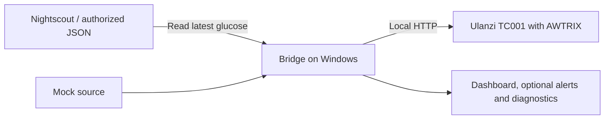

# Ulanzi Glucose Bridge

**Your glucose reading on an Ulanzi TC001, with a local Windows companion app.**

[Português (Brasil)](README.pt-BR.md) · [Report an issue](https://github.com/Ptraskus/ulanzi-glucose-bridge/issues) · [Releases](https://github.com/Ptraskus/ulanzi-glucose-bridge/releases)

The bridge reads an authorized Nightscout or JSON source and shows the glucose value, trend and reading status on the TC001. It works with the reading format supplied by the source, independently of the CGM manufacturer. The Windows app includes guided setup, a dashboard, optional alerts, a floating display and troubleshooting tools.

**Windows 10 1809+ / Windows 11 · Node.js 22+ · English by default, Brazilian Portuguese available · mg/dL or mmol/L · [MIT license](LICENSE)**

> This is an early release. The public download currently provides source code; a signed Windows installer is not yet published. Follow the source ZIP instructions below. Build scripts and a bundled-runtime package format are available for maintainers, but an internally built installer is not a signed public release.

> This is a supplementary display, not a medical device. Keep using your official apps, their alarms and your usual monitoring tools. Do not use this app or the TC001 as your only basis for treatment decisions. Initial thresholds are software defaults, not clinical recommendations.

## Quick start on Windows

You do not need Git, an account for this app, or `npm install`.

1. Install **Node.js LTS, version 22 or newer**, using the Windows installer from the [official Node.js download page](https://nodejs.org/en/download). Keep its default PATH option. Skip this step if a suitable Node.js version is already installed.
2. Download the repository using **Code > Download ZIP** on GitHub.
3. Right-click the ZIP and choose **Extract All**. Keep the extracted folder in a writable location such as your Documents folder. Open the folder containing `Start.cmd`; do not run it inside the ZIP or from `Program Files`.
4. Double-click **`Start.cmd`**. The launcher checks Node.js, then opens the dashboard. Select **Set up now** when the app asks for initial configuration.
5. Select your language and glucose unit, choose a source, enter the TC001 address and complete the connection tests. Review the settings before saving. **Automatic sound alerts start disabled.**

For subsequent use, open `Start.cmd` again. The app stays in the Windows notification area; closing the panel does not quit it. Use **Exit** from its tray menu to stop the app. The computer must remain awake, connected to the source and TC001, with the app running.

`Configure.cmd` opens the setup wizard directly. The original Portuguese commands, `configurar.cmd` and `iniciar.cmd`, remain available for compatibility. `iniciar.cmd` runs the bridge in a visible console; it does not open the dashboard.

If Windows blocks a downloaded script, verify that it came from this repository and review the warning. Do not disable system protection globally. Managed work or school computers may require assistance from their administrator.

### Try it without an account or clock

Open PowerShell in the extracted folder and run:

```powershell
npm.cmd run demo
```

This simulates **112 mg/dL**, prints the display payload and exits without contacting a real source or sending anything to a clock. It does not create configuration or credentials. It is a terminal demonstration; the full graphical setup still requires a TC001 for its device checks. Existing `.env` preferences can affect formatting, but the demo always uses the mock source with device delivery disabled.

### Future installer and portable packages

When a release includes a signed `Ulanzi-Glucose-Bridge-Setup-<version>.exe`, verify its publisher and the release checksums, then run it. It installs for the current user, offers English or Portuguese, and can create a desktop shortcut and start with Windows. A package marked `portable-node` includes Node.js and needs no separate runtime installation; extract it completely and open `Start.cmd`.

The GitHub **Source code (zip)** download does **not** include Node.js. Do not confuse it with a `portable-node` release asset. See [release and signing instructions](PUBLICACAO.md) for maintainers.

The bundled runtime contains Node.js and its license, without npm. To run the terminal demo from that package without installing Node globally:

```powershell
.\runtime\node\node.exe .\src\index.mjs --source=mock --once --dry-run
```

## What you need

| Item | Requirement |
| --- | --- |
| Computer | Windows 10 version 1809 or newer; Windows PowerShell 5.1 and WinForms. The desktop app is Windows-only. Packaged runtimes target x64. |
| Clock | Ulanzi TC001 with AWTRIX NG or AWTRIX 3, reachable from the computer on your local network. Original Ulanzi firmware is not supported. |
| Data source | An already working Nightscout instance or authorized JSON endpoint. A mock source is available for testing. |
| Network | Access to the data source and the TC001. The computer and clock must be able to communicate; guest network isolation can prevent this. |

### CGM compatibility

The bridge uses Nightscout's standard glucose-reading API; it does not identify or restrict the sensor manufacturer. A CGM can be used when its uploader or integration already provides current, valid glucose readings to your Nightscout instance. The bridge reads the value, timestamp and trend, without depending on manufacturer-specific device metadata. See Nightscout's [uploader documentation](https://nightscout.github.io/uploader/setup/) for the source side of that connection.

This is compatibility through the data source, not a claim that every sensor or uploader has been physically tested with the bridge. The application does not pair with a sensor or sign in to a manufacturer's cloud account. Installing and maintaining a sensor uploader or Nightscout server is a separate task. An authorized JSON endpoint is another supported input. See [Nightscout setup](GUIA-NIGHTSCOUT.md).

If the TC001 needs compatible firmware, setup links to the [official AWTRIX NG flashing tool](https://blueforcer.github.io/awtrix-ng/getting-started/flashing/). Read its instructions and back up the device first: replacing firmware can erase the existing software and settings. The bridge does not silently flash firmware or choose a serial port.

## How it works



The app validates the reading timestamp, checks its age, determines the display and optional alerts, and sends the result to the clock. Display commands expire so an old reading is not intended to remain indefinitely when delivery stops.

## Setup and everyday settings

Have your TC001 address, the source URL, and any required access token ready. Enter credentials only in the local wizard. Sensor-expiry estimation is optional and starts disabled; enable it only with the duration for your model and a reliable sensor-start event. Verify what you see and hear during the clock tests: a successful HTTP request alone cannot confirm the LEDs or buzzer worked.

| Area | What you can do |
| --- | --- |
| Home | Check the latest reading and the app, source, clock and sound status. |
| Alerts | Enable alarms and set thresholds, repeat intervals and sound patterns. |
| Display and sensor | Choose language and glucose unit, display options, refresh interval, sensor duration and floating display. |
| Connections | Check source and device connectivity, open Nightscout and rerun setup. |
| Support | Run diagnostics, export a sanitized report, restore configuration and restart. |

Use **Save and apply** to validate and persist changes. The app keeps the three most recent valid configurations for recovery. To change credentials or source addresses, rerun setup from Connections.

### Language and glucose units

English is the default for new installations. Select **English** or **Português (Brasil)** during setup, or use the **Language / Idioma** button at the bottom of the dashboard to open display settings. Existing explicit language preferences are preserved.

Choose **mg/dL** or **mmol/L** independently of the language. The display uses whole numbers for mg/dL and one decimal place for mmol/L. **Visual and alarm thresholds in settings remain explicitly labeled in mg/dL**, regardless of the reading unit. Changing units does not convert or round your saved thresholds. Internally, readings and environment variables ending in `_MGDL` use mg/dL. The JSON source always expects `valueMgDl`, even when displaying mmol/L. Switching the display unit does not change the source data.

### Initial behavior

| Setting | Default |
| --- | --- |
| Language | English (`APP_LANGUAGE=en`) |
| Display unit | mg/dL (`DISPLAY_UNITS=mgdl`); mmol/L is available. |
| Poll interval | 60 seconds. |
| Maximum reading age | 15 minutes. |
| Visual range | 70–180 mg/dL; configurable and independent from alarm thresholds. |
| Automatic sound alarms | Off. |
| Windows fallback notifications | Off. |
| Sensor-expiry estimate | Off (`SENSOR_LIFETIME_DAYS=0`). An optional model-specific duration supports fractional days, up to 365 days. |

The complete configuration reference is [.env.example](.env.example). For normal use, prefer the wizard, which saves credentials in the Windows-protected vault. Do not copy the example over an existing `.env`.

## Sources and reading states

| Source | Purpose | Authentication |
| --- | --- | --- |
| `nightscout` | Latest reading from your Nightscout instance. | Read access token or `API_SECRET`; the API secret is hashed before use in the header. |
| `json` | Authorized endpoint with the response format below. | Optional token. |
| `mock` | Simulated reading for testing. | None. |

Use the final HTTPS source URL without credentials in the URL. Plain HTTP sources are allowed only on the local computer (loopback). Source requests do not follow redirects, to avoid forwarding authentication to another destination. The TC001 uses local HTTP; see [AWTRIX network security](GUIA-SEGURANCA-AWTRIX.md).

Example JSON response with fictitious data:

```json
{
  "valueMgDl": 112,
  "trend": "flat",
  "timestamp": "2026-01-01T12:00:00Z"
}
```

Use the actual reading time; this example's timestamp will be stale if copied unchanged. Accepted trends: `double-up`, `up`, `up-slight`, `flat`, `down-slight`, `down`, `double-down`, `unknown`.

An unavailable or stale reading shows **NO DATA** (**SEM DADO** in Portuguese). If sensor-expiry estimation is enabled, a recorded Nightscout `Sensor Start` or `Sensor Change` event and your configured duration can produce a **CHANGE** (**TROCAR**) status. This is an estimate, not a sensor-reported end-of-life status. Without the event the app cannot infer expiry; ordinary glucose display still works. When the estimate is disabled, the bridge does not query sensor events. A still-valid low or high reading retains priority until it becomes stale. The sensor-change state does not trigger the no-data sound.

Automatic alerts are optional. Their visual thresholds and audible thresholds are independent. Sound profiles change beep patterns and repetition, not calibrated loudness. Hysteresis and rearming delays reduce repeated alerts near thresholds. The `double-down` arrow is displayed but currently has no dedicated sound rule. Test the clock's actual behavior before relying on notifications.

## Privacy and updates

There is no project telemetry, advertising, app account or project server. Glucose processing happens locally; the configured data service and firmware have their own behavior and privacy policies.

| Local path | Contents |
| --- | --- |
| `.env` | Service addresses and preferences. Do not share it. |
| `.secrets/` | Credentials protected with Windows DPAPI for the current Windows user. |
| `.runtime/` | Operational state and rotating logs. |
| `.config-history/` | Local recovery copies. |
| `.updates/` | Installers explicitly downloaded for updates. |

New UI preferences are stored under `%LOCALAPPDATA%\Ulanzi Glucose Bridge`. Upgrades can reuse the previous preference and installation folders to preserve existing data. These paths are excluded from source publication and release packages. A normal uninstall preserves user data. Credentials must be entered again when moving to another Windows account or computer.

Review diagnostic exports before sharing them, even though they remove readings and redact sensitive fields. Never attach `.env`, vault files, logs or screenshots containing private information to a public issue.

The updater stays disabled until a maintainer configures a release channel and expected publisher. When enabled, it checks HTTPS, SHA-256 and Authenticode before allowing installer execution. Publishing source code on GitHub does not activate automatic updates.

See [Privacy](PRIVACY.md), [Security](SECURITY.md), and the [private vulnerability report form](https://github.com/Ptraskus/ulanzi-glucose-bridge/security/advisories/new).

### Upgrading from the previous name

Version 0.3.0 renames the project from Ulanzi Libre Bridge to **Ulanzi Glucose Bridge**. Existing configuration, encrypted credentials, history and explicit sensor durations remain compatible. The old `LIBRE_SENSOR_LIFETIME_DAYS` setting is accepted as a fallback; `SENSOR_LIFETIME_DAYS` takes precedence when set. New configurations use the generic key and start with expiry estimation disabled. Changed duration settings use the generic key; saving without changes preserves the existing document.

Existing Windows installation and preference folders may retain their old names. Do not delete them to complete the rename. Stable internal Windows identifiers are deliberately retained for upgrade and single-instance compatibility. Exit the running copy before upgrading or opening the app from another folder.

## Troubleshooting

| Problem | Next step |
| --- | --- |
| Start says Node.js is missing or too old | Install Node.js LTS 22+ from the official site, then reopen Start. Extract every file if using a bundled-runtime ZIP. |
| Setup is required | Select Set up now. The bridge stays stopped until configuration is valid. |
| Start does not open another copy | Only one copy runs per Windows user. Use the existing tray icon; select Exit before launching from a different extracted or installed folder. |
| Clock does not respond | Confirm compatible AWTRIX firmware, address, credentials, firewall and local network access; repeat the wizard's clock test. |
| NO DATA | Check the source's timestamp, connectivity and maximum reading age. A successful connection does not guarantee a fresh reading. |
| No sound | Check the automatic-alert switch, clock buzzer and physical sound test in Support. |
| Unit or language is unexpected | Check Display and sensor. Language and glucose unit are independent preferences. |
| Credentials fail after moving the folder | Rerun setup under the target Windows account; a DPAPI vault cannot be copied as portable passwords. |
| Updates unavailable | A signed release channel is not configured; check GitHub for source changes. |

## Development and validation

```powershell
# Optional alternative to Download ZIP
git clone https://github.com/Ptraskus/ulanzi-glucose-bridge.git
cd ulanzi-glucose-bridge

# Syntax, tests and a no-network demo
npm.cmd run check
npm.cmd test
npm.cmd run demo

# Check launcher prerequisites without opening the app
powershell.exe -NoProfile -ExecutionPolicy Bypass -File .\scripts\launch-app.ps1 -Check

# Read the configured source without delivering to the clock
.\iniciar.cmd --once --dry-run

# Text-based setup for support
.\Configure.cmd -Console
```

The automated suite includes Windows PowerShell/WinForms checks; run the full suite on Windows. It cannot substitute for physical clock testing or clean-machine installation validation. Maintainer packaging, signing and release checks are in [PUBLICACAO.md](PUBLICACAO.md).

Source is in `src/`, Windows UI and tooling in `scripts/`, translations in `locales/`, installer definitions in `installer/`, and automated checks in `test/`. Keep personal configurations and credentials out of commits and pull requests. This is an independent community project, not affiliated with CGM manufacturers, Ulanzi, AWTRIX or Nightscout.
