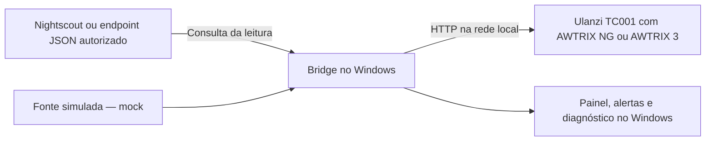

# Ulanzi Libre Bridge

**Sua leitura de glicemia no Ulanzi TC001, com um aplicativo local para Windows.**

O Ulanzi Libre Bridge consulta uma fonte Nightscout ou JSON autorizada e mostra o valor, a tendência e o estado da leitura no painel de LEDs do TC001. No computador, oferece assistente de configuração, painel de acompanhamento, alertas opcionais e ferramentas de diagnóstico.

**Versão:** `0.1.0` · **Plataforma:** Windows · **Runtime:** Node.js 22+ · **Licença:** [MIT](LICENSE)

> O projeto está em versão inicial e disponível como código-fonte. Ainda não há um instalador publicado em [Releases](https://github.com/Ptraskus/ulanzi-libre-bridge/releases). Os scripts para gerar instaladores estão incluídos; a distribuição assinada tem requisitos próprios descritos em [PUBLICACAO.md](PUBLICACAO.md).

> **Uso complementar:** este software não é um dispositivo médico e não substitui os aplicativos oficiais, seus alarmes, o glicosímetro ou a orientação profissional. Não use o TC001 como única fonte para decisões de tratamento.

## Neste README

- [O que a aplicação faz](#o-que-a-aplicação-faz)
- [Como funciona](#como-funciona)
- [Requisitos](#requisitos)
- [Começar pelo código-fonte](#começar-pelo-código-fonte)
- [Configuração e uso diário](#configuração-e-uso-diário)
- [Fontes de dados](#fontes-de-dados)
- [Alarmes e validade das leituras](#alarmes-e-validade-das-leituras)
- [Privacidade e segurança](#privacidade-e-segurança)
- [Solução de problemas](#solução-de-problemas)
- [Desenvolvimento e contribuição](#desenvolvimento-e-contribuição)
- [Documentação e licença](#documentação-e-licença)

## O que a aplicação faz

| Recurso | O que oferece |
| --- | --- |
| Visor do TC001 | Valor em mg/dL ou mmol/L, seta de tendência, cores configuráveis e indicação de leitura indisponível ou sensor encerrado. |
| Assistente inicial | Preparação do relógio, escolha da fonte, testes de conexão, preferências e revisão antes de salvar. |
| Painel no Windows | Leitura atual, estado da fonte e do relógio, alertas, mostrador flutuante e acesso pela bandeja do sistema. |
| Temas | Aparência clara, escura ou seguindo a preferência do Windows. |
| Alertas opcionais | Avisos sonoros por valor, tendência ou falta de dados, com limites, repetição e padrão de som configuráveis. |
| Diagnóstico | Testes do visor e buzzer, acompanhamento de falhas e exportação de relatório com remoção de dados sensíveis. |
| Recuperação | Histórico das três configurações válidas mais recentes e restauração pela interface. |
| Demonstração | Fonte simulada para conhecer o funcionamento sem conectar uma conta ou um relógio. |

O núcleo usa Node.js; a interface para Windows usa PowerShell e WinForms. Não há dependências npm de execução para instalar.

## Como funciona



O computador consulta a fonte, verifica a idade da leitura e calcula a apresentação e os alertas. O TC001 recebe os comandos pela rede local. **O computador precisa permanecer ligado, com o aplicativo em execução e acesso à fonte e ao relógio.**

O projeto não faz login no LibreLinkUp, não pede senha Abbott e não lê o sensor diretamente. Para dados reais, a fonte Nightscout ou JSON precisa estar funcionando antes da configuração do bridge. A instalação e a manutenção de um uploader ou de um servidor Nightscout são etapas separadas.

## Requisitos

| Item | Requisito |
| --- | --- |
| Sistema | Windows 10 versão 1809 ou mais recente; interface baseada em Windows PowerShell 5.1 e WinForms. |
| Node.js | Versão 22 ou mais recente, disponível no `PATH`, para executar o código-fonte. |
| Relógio | Ulanzi TC001 com [AWTRIX NG](https://github.com/Blueforcer/awtrix-ng) ou AWTRIX 3. Dispensável para a demonstração no terminal. |
| Rede | Computador e TC001 com comunicação permitida na rede local; acesso à fonte de dados configurada. |
| Fonte | Instância Nightscout controlada por você ou endpoint JSON autorizado. Para demonstração, use `mock`. |
| Git | Necessário apenas para clonar; também é possível baixar o código pelo botão **Code > Download ZIP** do GitHub. |

Se o TC001 ainda precisar de firmware, o assistente orienta a preparação e abre a [ferramenta oficial do AWTRIX NG](https://blueforcer.github.io/awtrix-ng/getting-started/flashing/) mediante sua confirmação. A gravação exige um cabo USB de dados e um navegador compatível com a ferramenta. Faça backup antes: a troca de firmware pode apagar o software e as configurações do relógio.

## Começar pelo código-fonte

Abra o PowerShell e baixe o projeto:

```powershell
git clone https://github.com/Ptraskus/ulanzi-libre-bridge.git
cd ulanzi-libre-bridge
node --version
```

Se baixou o ZIP, extraia-o e abra o PowerShell na pasta que contém `package.json`. Os comandos abaixo partem dessa pasta.

### 1. Experimentar com dados simulados

Em um clone novo, execute:

```powershell
npm.cmd run demo
```

O comando simula **112 mg/dL com tendência estável**, imprime os dados que seriam enviados ao AWTRIX NG e ao AWTRIX 3 e encerra. Não consulta uma fonte real nem envia comandos ao relógio. Não é necessário criar `.env`, configurar credenciais ou executar `npm install` para essa demonstração.

Se já existir um `.env`, suas opções também serão carregadas; a fonte continua sendo `mock` e o envio permanece desativado. Esse comando demonstra o processamento no terminal, sem abrir o painel gráfico.

### 2. Configurar a aplicação

```powershell
.\configurar.cmd
```

O assistente conduz sete etapas: preparação, AWTRIX NG, fonte de glicemia, conexão da fonte, TC001, preferências e revisão. Tenha em mãos o endereço do relógio, a URL da fonte e, quando necessário, suas credenciais de acesso.

Escolha a duração correspondente ao seu modelo de sensor e confirme os testes de conexão antes de concluir. **Os alarmes automáticos começam desligados.** Credenciais são informadas apenas na interface local; não as coloque em issues, capturas ou arquivos enviados ao GitHub.

### 3. Abrir o painel e manter o bridge na bandeja

```powershell
wscript.exe .\scripts\iniciar-oculto.vbs /OpenPanel
```

O painel abre e o aplicativo fica disponível na bandeja do Windows, perto do relógio do sistema. Use **Encerrar** no menu da bandeja para encerrá-lo. Se a configuração estiver incompleta, o painel oferece **Configurar agora** e mantém o bridge parado até a validação.

Para desenvolvimento ou suporte, também é possível executar em primeiro plano:

```powershell
.\iniciar.cmd
```

Esse comando mantém um terminal visível; use `Ctrl+C` para parar. Ele também é o comportamento de `npm.cmd start`.

## Configuração e uso diário

O painel reúne cinco áreas:

| Área | Ações principais |
| --- | --- |
| **Início** | Consultar a leitura e a situação do aplicativo, fonte, TC001 e som. |
| **Alertas** | Ajustar limites, padrões sonoros, repetições e ativação dos alarmes. |
| **Tela e sensor** | Configurar apresentação, atualização, duração do sensor e mostrador flutuante. |
| **Conexões** | Conferir fonte e entrega ao relógio, abrir o Nightscout e refazer a configuração. |
| **Suporte** | Executar diagnóstico, exportar relatório, recuperar configuração e reiniciar. |

**Salvar e aplicar** valida os campos, grava e confirma os valores e reinicia o bridge para aplicá-los. O aplicativo preserva as três configurações válidas mais recentes. Para trocar endereços, tokens ou senhas, use **Conexões > Refazer configuração**.

Os principais padrões estão abaixo. Eles descrevem o comportamento inicial do programa e **não são recomendações clínicas**.

| Opção | Padrão |
| --- | --- |
| Consulta da fonte | A cada 60 segundos. |
| Validade máxima da leitura | 15 minutos; depois disso, o visor mostra `SEM DADO`. |
| Unidade no visor | mg/dL; também aceita mmol/L. |
| Faixa visual inicial | Limites de 70 e 180 mg/dL, configuráveis. |
| Alarmes sonoros automáticos | Desligados. |
| Avisos de contingência no Windows | Desligados. |
| Duração do sensor | Escolha explícita no assistente: 14 dias, 15 dias ou valor personalizado. |

O arquivo [.env.example](.env.example) documenta as opções disponíveis. Para uso normal, prefira o assistente: ele mantém a correspondência entre configuração e cofre de credenciais. Não copie o `.env.example` por cima de uma instalação já configurada.

## Fontes de dados

| Fonte | Finalidade | Autenticação |
| --- | --- | --- |
| `nightscout` | Ler a entrada mais recente de uma instância Nightscout. | Access token ou `API_SECRET`; o `API_SECRET` é enviado como hash no cabeçalho da API. |
| `json` | Integrar um endpoint autorizado que forneça o formato abaixo. | Token opcional, conforme o serviço. |
| `mock` | Simular uma leitura para testes e demonstração. | Não exige credenciais. |

Use a URL HTTPS final da fonte, sem credenciais na URL. HTTP é aceito para fontes somente no próprio computador (`localhost`/loopback). As consultas de glicemia não seguem redirecionamentos para evitar o encaminhamento de autenticação a outro destino.

O [guia de integração com Nightscout](GUIA-NIGHTSCOUT.md) descreve a preparação da fonte e as limitações de conectores comunitários. O bridge não inclui nem mantém esses conectores.

### Contrato do endpoint JSON

Exemplo fictício de resposta:

```json
{
  "valueMgDl": 112,
  "trend": "flat",
  "timestamp": "2026-01-01T12:00:00Z"
}
```

O valor de entrada é em **mg/dL**, mesmo quando o visor está configurado em mmol/L. `timestamp` deve representar o instante real da leitura; a data fictícia acima ficará vencida se for reutilizada.

Tendências aceitas: `double-up`, `up`, `up-slight`, `flat`, `down-slight`, `down`, `double-down` e `unknown`. As cores e os alarmes são calculados localmente a partir da leitura e das configurações.

## Alarmes e validade das leituras

Os limites de cor do visor e os limites de alarme são independentes. Quando ativados, os alertas podem acompanhar valores baixos ou altos, tendências de subida ou queda e falta de dados. Histerese e intervalo de rearme reduzem repetições provocadas por pequenas oscilações.

- **Perfis de som:** `discreet`, `normal` e `reinforced`, com padrões mais breves ou repetidos. Eles mudam a duração e o padrão dos bipes; não representam um volume calibrado em dB.
- **Tendências:** há regras para `up`, `double-up`, `up-slight`, `down` e `down-slight`. A seta `double-down` é exibida, mas não possui uma regra sonora própria.
- **SEM DADO:** indica leitura indisponível ou vencida. A idade é calculada pelo horário da leitura, não pelo momento em que o computador a recebeu.
- **TROCAR:** com Nightscout, usa o evento mais recente `Sensor Start` ou `Sensor Change` e a duração configurada para indicar o fim previsto do sensor. Se essa informação não estiver disponível, o bridge mantém o tratamento de leitura vencida como `SEM DADO`.
- **Expiração no relógio:** os comandos incluem validade para evitar que uma leitura antiga permaneça no TC001 como se ainda estivesse atual quando o bridge parar.
- **Retentativas:** falhas de entrega são tratadas separadamente das consultas à fonte. O estado dos alarmes é salvo localmente para reduzir avisos duplicados após reinícios.

`TROCAR` é um aviso visual e não dispara o som de `SEM DADO`. Uma leitura baixa ou alta ainda válida mantém prioridade até vencer.

<details>
<summary><strong>Referência das principais opções de alarme</strong></summary>

| Variável | Padrão | Função |
| --- | --- | --- |
| `GLUCOSE_ALARM_ENABLED` | `false` | Controle geral dos alarmes automáticos. |
| `GLUCOSE_ALARM_SOUND_PROFILE` | `normal` | Padrão sonoro: `discreet`, `normal` ou `reinforced`. |
| `GLUCOSE_ALARM_LOW_THRESHOLD_MGDL` | `70` | Limite sonoro de baixa. |
| `GLUCOSE_ALARM_HIGH_THRESHOLD_MGDL` | `180` | Limite sonoro de alta. |
| `GLUCOSE_ALARM_UP_SLIGHT_THRESHOLD_MGDL` | `140` | Alerta de `up-slight` somente acima deste valor. |
| `GLUCOSE_ALARM_DOWN_THRESHOLD_MGDL` | `90` | Alerta de `down` e `down-slight` somente abaixo deste valor. |
| `GLUCOSE_ALARM_DOUBLE_UP_ENABLED` | `true` | Inclui `double-up` nos alertas de subida. |
| `GLUCOSE_ALARM_NO_DATA_ENABLED` | `true` | Alerta uma vez por episódio de falta de dados. |
| `GLUCOSE_ALARM_HYSTERESIS_MGDL` | `5` | Folga para rearmar os alarmes por valor. |
| `GLUCOSE_ALARM_COOLDOWN_MINUTES` | `5` | Intervalo mínimo antes de rearmar o mesmo alarme. |
| `GLUCOSE_ALARM_ON_STARTUP_EXTREME` | `true` | Permite alerta se a primeira leitura válida estiver baixa ou alta. |
| `GLUCOSE_ALARM_ON_RECOVERY_EXTREME` | `true` | Permite alerta se a leitura voltar de `SEM DADO` baixa ou alta. |
| `GLUCOSE_ALARM_MAX_DELIVERY_ATTEMPTS` | `3` | Tentativas por sequência de entrega de um comando sonoro. |
| `GLUCOSE_ALARM_DELIVERY_RETRY_SECONDS` | `30` | Intervalo entre tentativas de entrega. |
| `WINDOWS_FALLBACK_ALERT_ENABLED` | `false` | Avisos locais de contingência, sem mostrar o valor da glicemia. |
| `WINDOWS_STATUS_NOTIFICATION_DELAY_MINUTES` | `2` | Atraso antes de avisar sobre uma falha operacional persistente. |

As opções individuais só produzem alarmes automáticos quando o controle geral está ligado. Os limites permanecem em mg/dL mesmo com o visor em mmol/L. A histerese é validada para impedir a sobreposição dos limites de baixa e alta.

</details>

O diagnóstico pede confirmação do que você viu e ouviu: uma resposta HTTP confirma o recebimento do comando, mas não prova que os LEDs ou o buzzer funcionaram. O controle direto de ligar/desligar o buzzer depende do AWTRIX NG e do hardware anunciado pelo firmware; desligá-lo também afeta sons de outros aplicativos do relógio.

## Privacidade e segurança

O bridge não possui telemetria, publicidade, conta própria ou servidor do projeto. O processamento é local; a fonte escolhida, o firmware e eventuais serviços de atualização têm seus próprios comportamentos e políticas.

| Arquivo ou pasta local | Conteúdo |
| --- | --- |
| `.env` | Endereços e preferências de funcionamento; não deve ser compartilhado. |
| `.secrets/` | Credenciais protegidas pelo DPAPI, vinculadas ao usuário do Windows. |
| `.runtime/` | Estado operacional, alarmes e logs rotativos. |
| `.config-history/` | Cópias locais para recuperação da configuração. |
| `.updates/` | Arquivos de atualização baixados mediante ação do usuário. |

Esses caminhos ficam fora do Git. Apenas [.env.example](.env.example), com valores de exemplo, é publicado. Logs e relatórios passam por sanitização; revise qualquer exportação antes de compartilhá-la. A desinstalação preserva os dados locais por padrão.

A comunicação com o TC001 usa HTTP na rede local. Autenticação básica não criptografa o tráfego: mantenha o relógio em uma rede confiável e não exponha sua API à internet. Veja o [guia de segurança do AWTRIX](GUIA-SEGURANCA-AWTRIX.md).

O atualizador permanece desativado enquanto o distribuidor não configurar o canal e o publicador esperado. Quando configurado, verifica HTTPS, SHA-256 e assinatura Authenticode antes de permitir a execução do instalador. A publicação do código no GitHub, por si só, não ativa esse canal.

Consulte a [política de privacidade](PRIVACY.md) e a [política de segurança](SECURITY.md). Relate vulnerabilidades pelo [canal privado do GitHub](https://github.com/Ptraskus/ulanzi-libre-bridge/security/advisories/new).

## Solução de problemas

| Situação | O que verificar |
| --- | --- |
| `node` não é reconhecido | Instale Node.js 22 ou superior, reabra o terminal e confira `node --version`. |
| O painel pede configuração | Use **Configurar agora**. Uma configuração incompleta ou um cofre incompatível impede o início do bridge. |
| O TC001 não responde | Confira se ele usa AWTRIX, o endereço configurado, a rede local e os resultados dos testes do assistente. |
| O visor mostra `SEM DADO` | Verifique a leitura e seu horário na fonte, a conexão e o prazo de validade configurado. |
| A leitura aparece, mas não há som | Confira o controle geral dos alarmes, o buzzer do relógio e o teste auditivo em **Suporte**. |
| Credenciais não funcionam após mudar de usuário ou computador | Refaça a configuração: a proteção DPAPI não permite tratar o cofre como um arquivo portátil de senhas. |
| Atualizações indisponíveis | O canal fica inativo sem um manifesto e publicador configurados pelo distribuidor. |

Para uma falha persistente, abra **Suporte**, execute o diagnóstico e revise o relatório exportado antes de compartilhá-lo. Não publique `.env`, cofres, dados de glicemia ou capturas com informações pessoais.

## Desenvolvimento e contribuição

### Comandos disponíveis

```powershell
# Verificação de sintaxe do ponto de entrada
npm.cmd run check

# Suíte automatizada
npm.cmd test

# Demonstração com fonte simulada, sem envio ao relógio
npm.cmd run demo
```

A suíte inclui testes da lógica Node.js e da interface PowerShell/WinForms; use Windows para validar o conjunto. Testes automatizados não substituem a confirmação física de visor, som e instalação em um TC001 real.

Depois de configurar uma fonte, estes comandos ajudam no diagnóstico:

```powershell
# Consulta a fonte configurada e imprime o resultado sem enviar ao TC001
.\iniciar.cmd --once --dry-run

# Consulta a fonte configurada e envia uma leitura ao TC001
.\iniciar.cmd --once

# Configurador textual, para suporte
.\configurar.cmd -Console
```

### Organização do projeto

```text
src/           Consulta de fontes, validação, visor, alarmes e diagnóstico
src/sources/   Adaptadores Nightscout, JSON e mock
scripts/       Interface Windows, configuração, execução e build
test/          Testes automatizados
installer/     Definição do instalador e inicializadores
release/       Lista de arquivos permitidos e contratos de atualização
assets/        Ícone da aplicação
presentation/  Roteiro e gerador da apresentação técnica
```

Para contribuir, abra uma [issue](https://github.com/Ptraskus/ulanzi-libre-bridge/issues) ou um pull request com o problema, a mudança proposta e como ela foi validada. Use dados fictícios nos exemplos e execute os testes relevantes. Vulnerabilidades e segredos devem seguir o canal privado de segurança.

## Documentação e licença

| Documento | Conteúdo |
| --- | --- |
| [GUIA-NIGHTSCOUT.md](GUIA-NIGHTSCOUT.md) | Preparação da fonte Nightscout e limitações das integrações. |
| [GUIA-SEGURANCA-AWTRIX.md](GUIA-SEGURANCA-AWTRIX.md) | Cuidados com firmware, provisionamento e rede do relógio. |
| [.env.example](.env.example) | Referência das opções de configuração. |
| [PRIVACY.md](PRIVACY.md) | Dados processados, armazenamento local e controle do usuário. |
| [SECURITY.md](SECURITY.md) | Escopo de segurança e comunicação de vulnerabilidades. |
| [PUBLICACAO.md](PUBLICACAO.md) | Build, assinatura, instaladores, atualização e publicação. |
| [Apresentação técnica](presentation/ROTEIRO-APRESENTACAO.md) | Visão da arquitetura e pontos para discussão técnica. |

O código deste projeto está sob a [licença MIT](LICENSE). AWTRIX, Nightscout, Node.js e outros componentes externos mantêm suas próprias licenças e condições de uso.
