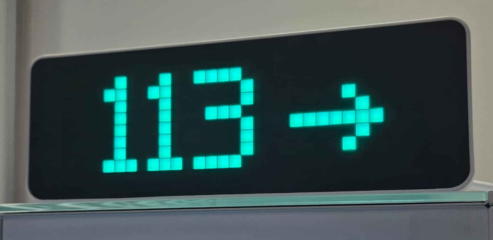

# Ulanzi Glucose Bridge

**Sua glicemia em números grandes, com a seta de tendência ao lado, no Ulanzi TC001.**

[English — documentação completa](README.md) · [Relatar problema](https://github.com/Ptraskus/ulanzi-glucose-bridge/issues) · [Releases](https://github.com/Ptraskus/ulanzi-glucose-bridge/releases)

Veja a glicemia e sua tendência de relance no relógio. O Ulanzi Glucose Bridge é um aplicativo para Windows que busca a leitura no seu Nightscout e a envia ao TC001 pela rede local. Também aceita uma fonte JSON autorizada para integrações próprias.



*Foto do relógio em uso: o valor e a seta dividem o visor, com destaque para a leitura.*

**Windows 10 1809+ / Windows 11 · Node.js 22+ · Inglês como padrão, português disponível · mg/dL ou mmol/L · [Licença MIT](LICENSE)**

[Ir para o passo a passo](#passo-a-passo-no-windows) · [Resolver um problema](#privacidade-e-suporte)

## O que esta versão oferece

- **Números que usam toda a altura do visor.** No AWTRIX NG, os dígitos são desenhados pixel a pixel e ocupam as 8 linhas da tela de 32 × 8 pixels. Isso dá destaque ao valor e facilita a leitura de relance.
- **Seta grande ao lado da glicemia.** A tendência tem um desenho próprio em uma área de até 7 × 8 pixels. A posição acompanha a largura do valor, com espaço entre números e seta para manter os dois legíveis.
- **Espaço dedicado ao essencial.** O conjunto de números e seta é posicionado conforme o espaço disponível. O visor mostra o valor e a tendência, sem gastar espaço com o nome da unidade; você escolhe mg/dL ou mmol/L no aplicativo.
- **Cores para identificar a faixa.** Valor e seta mudam de cor conforme os limites configurados. Quando a leitura está indisponível ou antiga, o aplicativo mostra `SEM DADO`.
- **Configuração por janelas, em português.** O assistente orienta a conexão, procura o relógio e testa a fonte. Depois, o painel reúne ajustes, diagnóstico e recuperação de configuração.
- **Recursos opcionais para o dia a dia.** Mostrador flutuante no Windows e alertas sonoros configuráveis. O processamento acontece no seu computador, sem conta própria do aplicativo, anúncios ou telemetria do projeto.

**Para usar o desenho de números grandes e seta descrito acima, o relógio precisa estar com AWTRIX NG.** O AWTRIX 3 também é compatível, mas recebe a leitura em modo texto e a aparência pode ser diferente.

> Uso complementar: este aplicativo não é um dispositivo médico. Continue usando os aplicativos oficiais, seus alarmes e os métodos habituais de monitoramento. Não use o TC001 como única referência para decisões de tratamento. Os limites iniciais são padrões do software, não recomendações clínicas.

## Antes de começar

| Você precisa de | Em palavras simples |
| --- | --- |
| Um computador Windows | Windows 10 versão 1809 ou mais recente, ou Windows 11. Ele executa o aplicativo e precisa ficar ligado, sem suspender, para continuar enviando as leituras. |
| Um Ulanzi TC001 com AWTRIX | AWTRIX é o software instalado dentro do relógio, também chamado de firmware. O software original da Ulanzi não é compatível. O assistente orienta o preparo se necessário. |
| Computador e relógio na mesma rede local | O TC001 recebe os dados pelo Wi-Fi. O computador pode usar Wi-Fi ou cabo, desde que consiga se comunicar com o relógio. |
| Nightscout já recebendo suas leituras | É o site que reúne os dados do seu sensor. Tenha o endereço do site e, se exigido, um token de acesso ou `API_SECRET` — a credencial usada para permitir a leitura. |

O caminho dos dados é: **sensor → Nightscout → aplicativo no Windows → relógio**. A conexão do sensor ao Nightscout precisa estar funcionando antes; este aplicativo cuida do trecho entre a fonte e o relógio. Ele não se conecta diretamente ao sensor nem pede a senha da conta do fabricante.

**Ainda não tem Nightscout?** Consulte o [guia de integração](GUIA-NIGHTSCOUT.md), em inglês, antes de configurar leituras reais. Quem já tem outra integração pode usar uma fonte JSON autorizada. Para apenas conhecer o funcionamento, há uma demonstração no final deste documento.

## Passo a passo no Windows

Para configurar pelo assistente, você não precisa programar, usar Git, digitar comandos ou executar `npm install`.

> O download público é o código-fonte em ZIP. Ainda não há instalador Windows assinado publicado. O caminho abaixo permite abrir o aplicativo a partir da pasta extraída.

### 1. Instale o Node.js uma vez

O Node.js é o programa que permite executar este aplicativo. Baixe o **instalador para Windows da versão LTS, 22 ou mais recente**, pelo [site oficial do Node.js](https://nodejs.org/en/download). Abra o instalador e mantenha as opções padrão, incluindo **Add to PATH**. Se já tiver uma versão compatível instalada, pule esta etapa.

### 2. Baixe e extraia o aplicativo

1. Abra a [página do projeto no GitHub](https://github.com/Ptraskus/ulanzi-glucose-bridge).
2. Acima da lista de arquivos, clique no botão **Code** e depois em **Download ZIP**.
3. Na pasta Downloads do Windows, clique com o botão direito no ZIP e escolha **Extrair Tudo**.
4. Escolha uma pasta sua, como **Documentos**, e conclua a extração. Abra a pasta extraída até encontrar o arquivo `Start.cmd`.

Extraia a pasta inteira; o aplicativo precisa dos demais arquivos. Não abra `Start.cmd` de dentro do ZIP nem guarde o projeto em `Program Files`.

### 3. Abra o painel

Dê dois cliques em **`Start.cmd`**. Se o Windows esconder as extensões, ele pode aparecer apenas como **Start**. O aplicativo verifica o Node.js e abre o painel.

Na primeira abertura, clique em **Set up now** (Configurar agora). Selecione **Português (Brasil)** quando aparecer a escolha de idioma.

Caso o Windows bloqueie um script baixado, confira a procedência e o aviso. Não desative a proteção do sistema globalmente. Computadores gerenciados podem exigir suporte do administrador.

### 4. Siga as telas do assistente

| Etapa | O que fazer |
| --- | --- |
| Preparar o relógio | Se ele já mostra AWTRIX e está conectado ao Wi-Fi, marque essa opção. Caso contrário, siga os botões do assistente para instalar o AWTRIX e configurar o Wi-Fi. A instalação do firmware pode apagar a configuração anterior: faça backup antes e use um cabo USB de dados. |
| Escolher a fonte | Selecione **Nightscout** se esse é o site que já recebe as leituras do seu sensor. A opção JSON é para quem já tem uma integração própria. |
| Conectar a fonte | Informe o endereço principal do seu Nightscout, começando com `https://`, sem `/api/...` nem `?token=...`. Escolha a autenticação usada no seu site e preencha a credencial no campo separado. Em **Access token**, cole só o valor do token. Clique em **Testar Nightscout** antes de avançar. |
| Encontrar o TC001 | Clique em **Procurar**. Se ele não for encontrado, digite o endereço IP do relógio, no formato `http://192.168.1.50`. Esse endereço é apenas um exemplo: use o IP do seu TC001. Preencha usuário e senha HTTP somente se estiverem configurados no AWTRIX, depois clique em **Testar TC001**. |
| Escolher preferências | Selecione **mg/dL** ou **mmol/L** e revise os limites de cor. Os alarmes automáticos começam desligados. A estimativa de término do sensor também é opcional e começa desligada; só ative com a duração correta do modelo e eventos confiáveis de início. |
| Concluir | Confira o resumo e clique em **Salvar e ativar**. O aplicativo salva a configuração e inicia o envio das leituras. |

Os links **Onde encontro esta URL?**, **Como escolher e preencher?** e **Onde encontro o endereço?**, dentro do assistente, explicam os campos. Para preparar o relógio, ele abre a [ferramenta oficial do AWTRIX NG](https://blueforcer.github.io/awtrix-ng/getting-started/flashing/); nenhuma gravação de firmware começa automaticamente.

### 5. Confira o resultado

Com uma leitura atual e conexões funcionando, o relógio deve exibir **o valor da glicemia e a tendência**. No painel, confira a leitura e os estados da fonte e do relógio. Compare também o horário da leitura com o Nightscout: conseguir conectar não garante que o site esteja recebendo dados novos.

Se aparecer `SEM DADO`, confira a conexão e o horário da última leitura na fonte. Se quiser alertas sonoros, ative-os na área **Alertas** e faça o teste de som em **Suporte**, verificando o som no próprio relógio.

## Como usar no dia a dia

- **Para abrir:** dê dois cliques em `Start.cmd`.
- **Para deixar funcionando:** mantenha o computador ligado, sem suspender, conectado à fonte e ao TC001. Os dados chegam ao relógio pela rede; o USB serve para alimentação e, no preparo inicial, instalação do firmware.
- **Para fechar só o painel:** use o X da janela. O aplicativo continua na bandeja do Windows, a área de ícones perto do relógio do computador; o ícone pode estar dentro da seta de ícones ocultos.
- **Para parar o aplicativo:** use **Encerrar** no menu do ícone da bandeja.
- **Para mudar ajustes:** use o painel e clique em **Salvar e aplicar**. Para refazer a conexão, use **Conexões** ou abra `Configure.cmd`.

## Compatibilidade com sensores

A aplicação lê o formato padrão do Nightscout, independentemente da marca do sensor de glicose (CGM). Outros sensores podem ser usados quando seu uploader — o programa que envia as leituras — ou integração já fornece dados atuais e válidos ao Nightscout. A ponte utiliza valor, horário e tendência; não depende de metadados específicos do fabricante. Consulte a [documentação de uploaders do Nightscout](https://nightscout.github.io/uploader/setup/) para preparar essa conexão.

Essa compatibilidade depende da fonte de dados e não significa que todos os modelos tenham sido testados fisicamente. Preparar Nightscout e seu uploader é uma etapa separada. Um endpoint JSON autorizado também é aceito, no formato descrito no [README em inglês](README.md#sources-and-reading-states).

## Idioma, unidade e preferências

O idioma padrão é inglês. Você pode escolher **English** ou **Português (Brasil)** no assistente ou pelo botão **Language / Idioma**, na parte inferior do painel, que abre as preferências de tela. A unidade é independente do idioma: **mg/dL** ou **mmol/L**.

A leitura em mg/dL usa inteiros; mmol/L usa uma casa decimal. **Os limites visuais e de alarme continuam explicitamente em mg/dL**, mesmo com leituras em mmol/L. Trocar a unidade não converte nem arredonda seus limites. A entrada JSON `valueMgDl` e variáveis terminadas em `_MGDL` também permanecem em mg/dL.

| Padrão | Valor inicial |
| --- | --- |
| Idioma | Inglês. |
| Unidade da leitura | mg/dL. |
| Consulta da fonte | A cada 60 segundos. |
| Validade máxima da leitura | 15 minutos. |
| Limites visuais | 70 e 180 mg/dL, configuráveis. |
| Alarmes automáticos e avisos de contingência | Desligados. |
| Estimativa de fim do sensor | Desligada (`SENSOR_LIFETIME_DAYS=0`). Duração opcional conforme seu modelo, até 365 dias, aceitando frações de dia. |

O painel reúne Início, Alertas, Tela e sensor, Conexões e Suporte. **Salvar e aplicar** valida e grava as alterações; até três configurações válidas são preservadas para recuperação. Para mudar endereços ou credenciais, refaça a configuração por Conexões.

`SEM DADO` indica leitura indisponível ou vencida. A estimativa opcional `TROCAR` depende de um evento `Sensor Start`/`Sensor Change` no Nightscout e da duração que você configurar. Ela não representa um aviso de término enviado pelo próprio sensor. Sem esse evento, a glicemia continua funcionando, mas não há estimativa de término. Com a opção desligada, a ponte nem consulta esses eventos. Uma leitura baixa ou alta ainda válida tem prioridade sobre `TROCAR`, que não dispara o som de falta de dados. Os alarmes são opcionais, e os limites de som são independentes das cores. Confirme fisicamente os LEDs e o buzzer nos testes.

Veja a referência completa em [.env.example](.env.example) e no [README em inglês](README.md). Para uso normal, prefira o assistente em vez de editar os arquivos.

## Atualização do nome anterior

A versão 0.3.0 passa de Ulanzi Libre Bridge para **Ulanzi Glucose Bridge**. Configurações, credenciais protegidas, histórico e durações explicitamente configuradas continuam compatíveis. A chave antiga `LIBRE_SENSOR_LIFETIME_DAYS` é aceita como alternativa; `SENSOR_LIFETIME_DAYS` tem prioridade quando definida. Alterações na duração são gravadas na chave genérica; salvar sem alterações preserva o documento existente. Novas configurações começam com a estimativa de término desligada.

Instalações e preferências existentes podem manter a pasta anterior para preservar os dados. Não apague essas pastas por causa da mudança de nome. Encerre a cópia em execução antes de atualizar ou abrir de outra pasta.

## Privacidade e suporte

Não há telemetria, anúncios, conta própria ou servidor do projeto. Credenciais ficam protegidas pelo DPAPI do Windows; `.env`, `.secrets/`, `.runtime/`, `.config-history/` e `.updates/` são locais e não entram no pacote público. Não compartilhe esses arquivos. Ao mudar de computador ou de usuário Windows, refaça a configuração das credenciais.

O TC001 usa HTTP local; mantenha-o em uma rede confiável, sem expor sua API à internet. Veja [segurança do AWTRIX](GUIA-SEGURANCA-AWTRIX.md), [privacidade](PRIVACY.md) e [segurança do projeto](SECURITY.md), em inglês.

| Problema | O que conferir |
| --- | --- |
| Node.js ausente ou antigo | Instale a versão LTS 22+ e abra Start novamente. |
| Configuração pendente | Conclua o assistente; a ponte fica parada até a validação. |
| Start não abre outra cópia | Apenas uma cópia roda por usuário Windows. Use o ícone existente na bandeja e encerre antes de abrir de outra pasta. |
| TC001 sem resposta | Firmware AWTRIX, endereço, credenciais, firewall e rede local. |
| SEM DADO | Horário real da leitura na fonte, conexão e validade configurada. |
| Sem som | Controle geral dos alarmes, buzzer e teste físico em Suporte. |
| Atualizações indisponíveis | O canal assinado ainda precisa ser configurado pelo distribuidor. |

Revise relatórios exportados antes de anexá-los a uma issue. Vulnerabilidades devem ser relatadas pelo [canal privado](https://github.com/Ptraskus/ulanzi-glucose-bridge/security/advisories/new), sem publicar dados pessoais.

Para desenvolvimento, execute `npm.cmd run check` e `npm.cmd test` no Windows. Testes automatizados não substituem a validação física no TC001. As instruções de empacotamento e assinatura estão em [PUBLICACAO.md](PUBLICACAO.md), em inglês.

## Opções adicionais

<details>
<summary>Demonstração sem conta ou relógio (opcional, pelo PowerShell)</summary>

Abra o PowerShell na pasta extraída:

```powershell
npm.cmd run demo
```

O comando simula **112 mg/dL**, imprime o resultado e encerra. Não consulta fonte real, não envia ao relógio nem cria credenciais. A demonstração é no terminal; o assistente gráfico completo exige TC001 para os testes do dispositivo. Preferências existentes no `.env` podem afetar a apresentação, mas a fonte continua simulada e o envio fica desativado.

</details>

<details>
<summary>Instalador e pacotes futuros</summary>

Quando houver instalador assinado nos Releases, verifique o publicador e os checksums antes de instalar. Um ZIP com `portable-node` no nome inclui o Node.js; basta extraí-lo completamente e abrir `Start.cmd`. O ZIP do código-fonte do GitHub **não inclui** o Node.js. Os pacotes com Node.js incluído são para Windows x64.

O runtime do pacote inclui `node.exe` e sua licença, sem npm. Para a demonstração nesse pacote, use `.\runtime\node\node.exe .\src\index.mjs --source=mock --once --dry-run` no PowerShell.

O instalador oferece inglês ou português e atalhos opcionais na área de trabalho e na inicialização do Windows. Instala apenas para o usuário atual. A desinstalação preserva os dados locais por padrão. Um instalador gerado para testes internos não equivale a uma distribuição pública assinada.

</details>

<details>
<summary>Comandos antigos e configuração direta</summary>

`Configure.cmd` abre diretamente o assistente. Os comandos antigos `configurar.cmd` e `iniciar.cmd` continuam funcionando; `iniciar.cmd` executa a ponte em um terminal visível, sem abrir o painel. Para o uso normal com janelas, abra `Start.cmd`.

</details>
